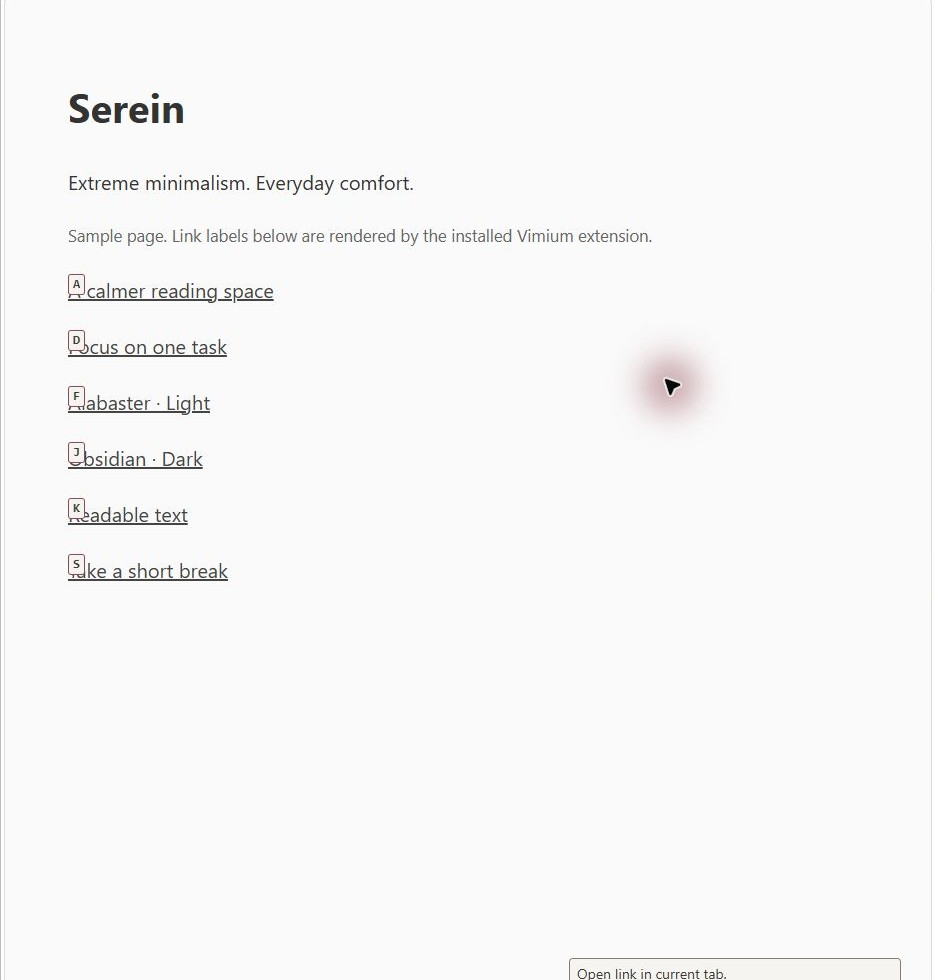
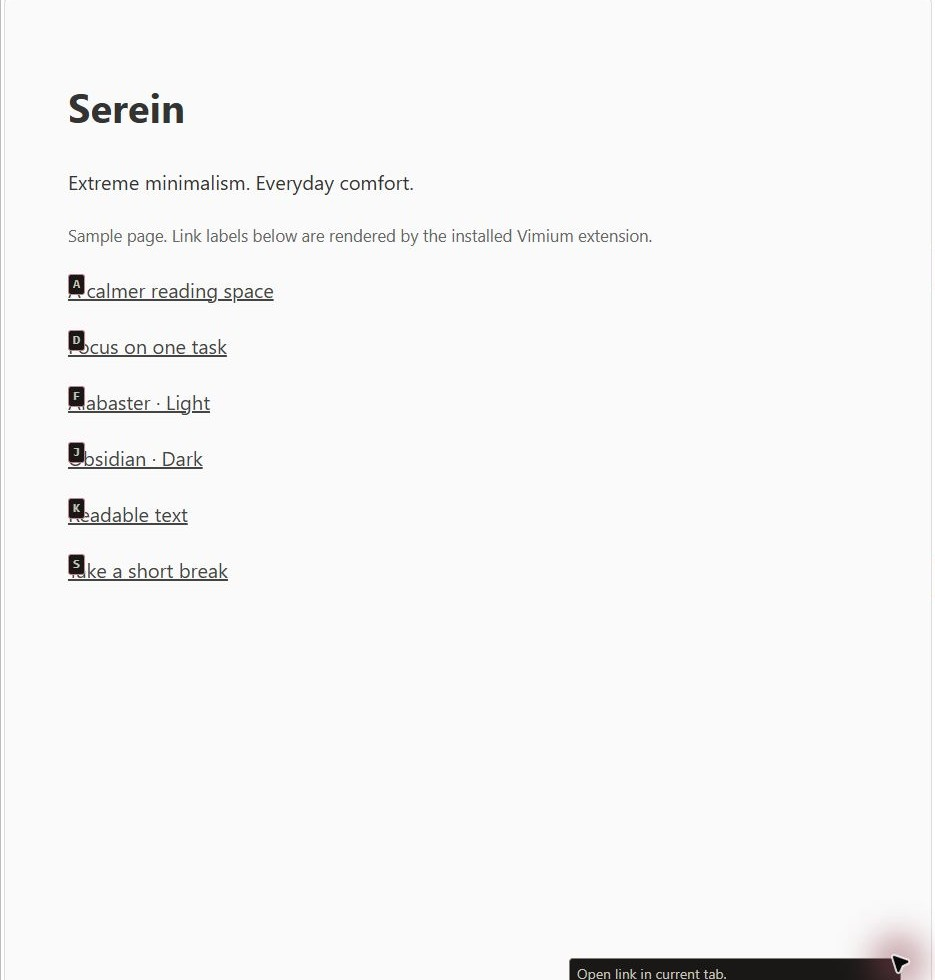

# Serein for Vimium

**Extreme minimalism. Everyday comfort.**

Warm surfaces, readable text and restrained accents. Alabaster is light; Obsidian is dark.

[Download](https://github.com/cmduyeen/serein-vimium/releases/latest) · [All Serein themes](https://github.com/cmduyeen/serein-theme) · [Evidence and limitations](https://github.com/cmduyeen/serein-theme/blob/main/REFERENCE.md)

## Screenshots

Actual installed Vimium extension rendering link hints and HUD on a local sample page. The web page itself is not themed. Click an image for downloads.

| Alabaster · Light | Obsidian · Dark |
|---|---|
|  |  |

## Install

Copy one CSS file into Vimium Options → Advanced Options → CSS for Vimium UI, then save. `copy-theme.ps1 -Mode Auto` copies the system-following variant. For original Vimium; Vimium C compatibility is not established.

## Why Serein?

- Checked contrast for declared palette pairs.
- Fewer competing colors, with clear focus and functional states.
- Native or scoped customization, with adjustable typography where supported.

Themes are not medical treatments. Serein has not been clinically tested. Brightness, glare, text size, vision and breaks also matter. [AAO guidance](https://www.aao.org/eye-health/diseases/computer-usage) · [Reading-size research](https://pmc.ncbi.nlm.nih.gov/articles/PMC7720185/).

## License

[MIT](LICENSE). See the [shared reference](https://github.com/cmduyeen/serein-theme/blob/main/REFERENCE.md) for scope and maintenance guidance.
